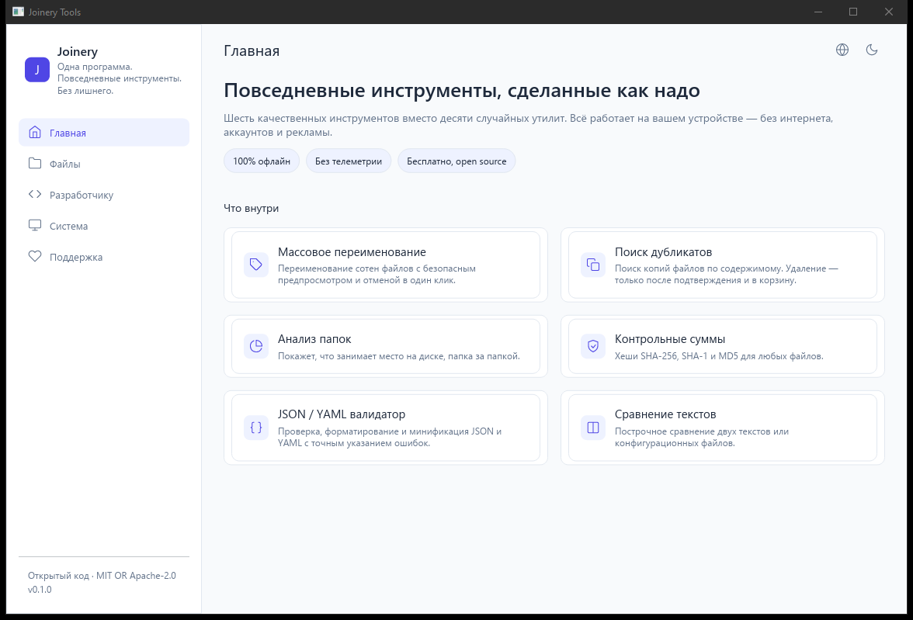
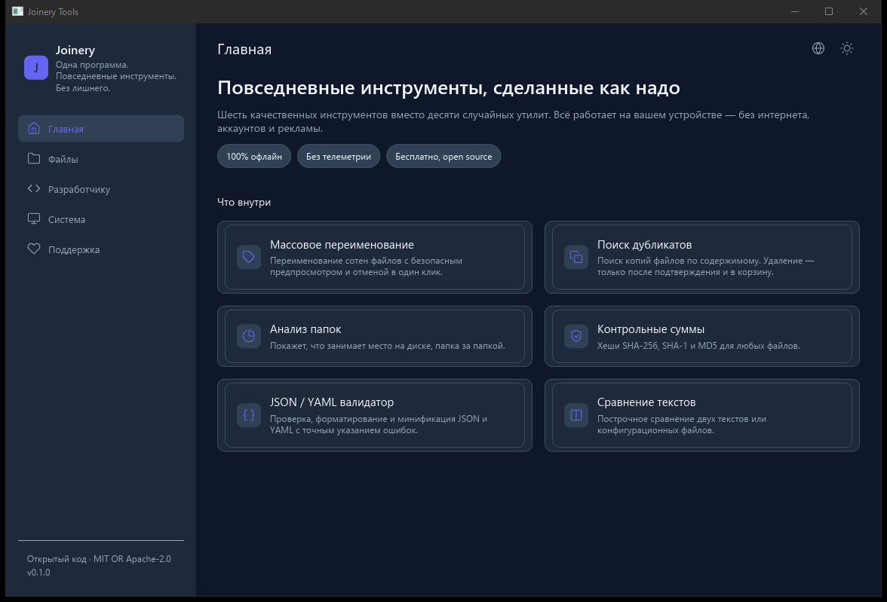
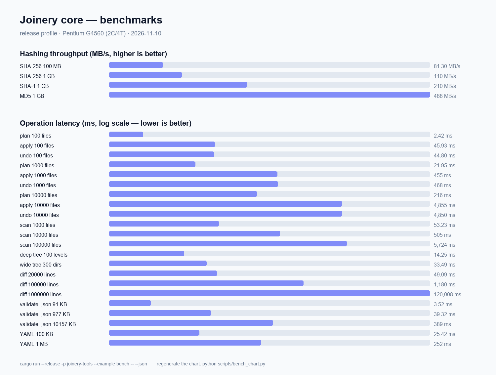

# Joinery Tools

> One app. Everyday tools. No nonsense.
> Одна программа. Повседневные инструменты. Без лишнего.

Joinery Tools is a local-first desktop toolbox for everyday work with files,
text and your system. Everything runs on your device — no internet, no
accounts, no ads, no telemetry.

[Русская версия ниже](#joinery-tools-по-русски)

## Why Joinery

- **Local-first.** Every operation happens on your device. Joinery has no
  network features at all.
- **Lightweight.** Built with Rust and [iced](https://iced.rs/) on the
  tiny-skia renderer. A single process, small binary, fast start and low
  memory use — useful even on weak machines.
- **Safe by design.** Destructive operations require a preview and an
  explicit confirmation. Renames are undoable, deletions go to the system
  trash.
- **Free & open source.** No subscriptions, no locked features, no ads.
  Voluntary donations keep the project alive.

## Tools in 0.1

| Tool | What it does |
| --- | --- |
| **Batch Renamer** | Rename hundreds of files with find/replace, prefix/suffix, numbering patterns (`photo_{n:3}`). Full preview, collision protection, one-click undo. |
| **Duplicate Finder** | Find duplicate files by content (size → partial hash → full hash). Nothing is deleted without confirmation; files go to the trash. |
| **Folder Analyzer** | See what is eating your disk space — per-folder sizes, largest files. |
| **Checksum** | SHA-256, SHA-1 and MD5 hashes, streamed with 1 MiB read buffers; verify against an expected hash. |
| **JSON / YAML Validator** | Validate, pretty-print and minify with exact error positions. |
| **Text Diff** | Line-by-line comparison of two texts or config files. |

Also included: a History page with one-click undo of past renames,
empty-state hints with recent folders, dark & light themes, English &
Russian UI, SQLite-backed settings and undo journal.

## Screenshots

| Light | Dark |
| --- | --- |
|  |  |

## Download

Grab a ready binary from the
[Releases](https://github.com/notfelixx1/joinery/releases/latest) page —
Windows, Linux and macOS builds are attached to every release.

## Command line

Launch straight on a tool, with a preset theme, language or folder:

```bash
joinery --renamer --folder "D:\photos" --dark
joinery --duplicates --lang ru
```

Flags: `--renamer` `--duplicates` `--analyzer` `--checksum` `--jsonyaml`
`--diff` `--history` `--system` `--support` open the matching tool,
`--dark` / `--light` override the saved theme, `--lang en|ru` switches
the language, `--folder <path>` preselects a folder, `--help` prints
the list.

## Benchmarks

Measured on the developer's machine (Pentium G4560, 2 cores, release
profile) — absolute numbers vary by hardware, the relative picture is
what matters:



Reproduce:

```bash
cargo run --release -p joinery-tools --example bench -- --json
python scripts/bench_chart.py bench.json docs/benchmarks.png
```

## Building from source

Requirements: [Rust](https://rustup.rs) 1.89+ and the usual platform build
prerequisites for `iced` / `tiny-skia`.

```bash
cargo build --release -p joinery
```

The binary will be at `target/release/joinery.exe` (Windows) or
`target/release/joinery` (Linux/macOS).

Run the test suite:

```bash
cargo test
```

## Project layout

```
core/               Rust core library (joinery-tools)
├── src/core/       renamer, duplicates, analyzer, checksum, text_diff, validators
├── src/safety/     path checks, preview, undo journal
└── src/storage/    SQLite (settings + undo journal)
native-ui/          iced frontend
├── src/app/        per-tool state, messages and update loops
└── src/views/      tool views
```

## Support Joinery

Joinery is free. If it saves you time, a small donation helps fix bugs, test
on more platforms and keep the software independent:

- [Ko-fi](https://ko-fi.com/notfst)

No subscriptions. No locked features. No pressure.

## License

Dual-licensed under [MIT](LICENSE-MIT) OR [Apache-2.0](LICENSE-APACHE) —
pick whichever suits your project.

---

# Joinery Tools (по-русски)

Локальный набор инструментов для повседневной работы с файлами, текстом и
системой. Все операции выполняются на устройстве: без интернета, аккаунтов,
рекламы и телеметрии.

**Философия:** программа должна быть полезной даже на слабых компьютерах —
никаких облачных API и обязательного ИИ. Одна программа вместо десяти мелких
утилит.

**Инструменты 0.1:** массовое переименование файлов (с предпросмотром и
отменой), поиск дубликатов (удаление только в корзину и после
подтверждения), анализ занятого места, контрольные суммы SHA-256/SHA-1/MD5,
валидатор JSON/YAML, сравнение текстов.

**Безопасность — преимущество продукта:** опасные операции никогда не
выполняются сразу. Сначала предпросмотр, затем подтверждение; журнал
изменений позволяет отменить переименование; удаление — в системную
корзину.

**Монетизация:** весь функционал бесплатен. Разработка поддерживается
добровольными донатами на [Ko-fi](https://ko-fi.com/notfst).

## Скачать

Готовые сборки — на странице
[Releases](https://github.com/notfelixx1/joinery/releases/latest):
Windows, Linux и macOS, к каждому релизу.

## Сборка из исходников

Требования: [Rust](https://rustup.rs) 1.89+.

```bash
cargo build --release -p joinery
```

Исполняемый файл появится в `target/release/joinery` (или
`target/release/joinery.exe` на Windows).
